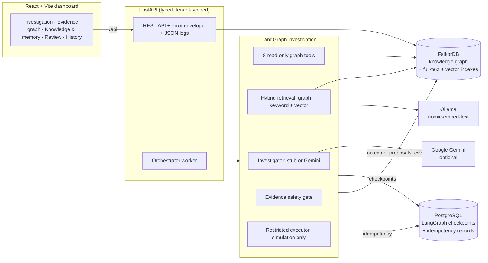
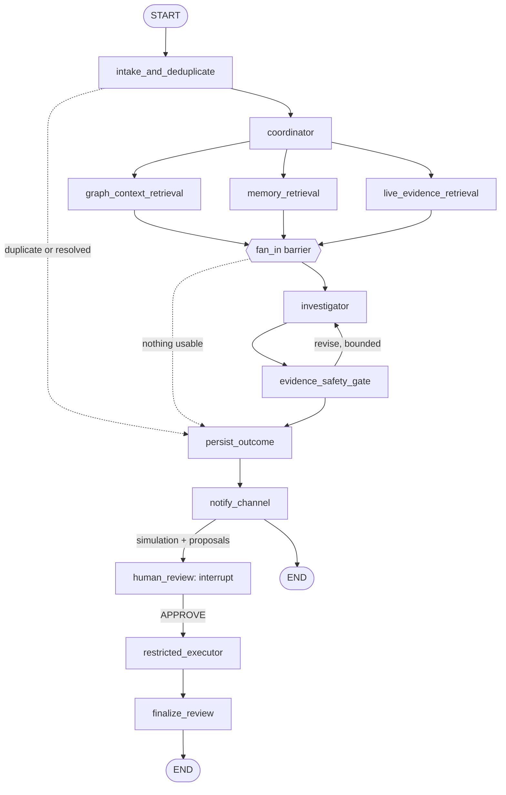

# Graphathon: Graph-Grounded Incident Investigator

**An AI incident investigator whose reasoning is grounded in a knowledge graph. Every claim cites real graph evidence, every recommendation passes a safety gate, and a human approves every action.**

When production breaks, on-call engineers have to answer three questions fast:

1. *What changed?*
2. *What depends on it?*
3. *Who is allowed to fix it, and how?*

The answers are spread across deployments, service dependencies, runbooks, policies, past postmortems and tribal memory. This project puts all of that in a **FalkorDB knowledge graph**. A **LangGraph** multi-step agent investigates over it with **hybrid GraphRAG**, and the result is a recommendation that is explainable, auditable and safe.

> **All data is synthetic.** *NovaCommerce* is a fictional e-commerce company. Nothing here touches a real system, and the only executable action is a **simulated** rollback.

---

## Contents
- [What it does](#what-it-does)
- [How it works](#how-it-works)
- [Concepts and techniques](#concepts-and-techniques)
- [Tech stack](#tech-stack)
- [Requirements](#requirements)
- [Quick start](#quick-start)
- [Demo walkthrough](#demo-walkthrough)
- [API overview](#api-overview)
- [Error handling, safety and reliability](#error-handling-safety-and-reliability)
- [Testing](#testing)
- [Project structure](#project-structure)
- [Limitations and future work](#limitations-and-future-work)
- [Further documentation](#further-documentation)

---

## What it does

**The golden scenario.** At 13:52 the `payment` service ships **v2.4**. At 14:04 **INC-101** opens: *"Checkout 5xx spike"*.

The investigator:

1. **Finds the evidence path in the graph.** Checkout **depends on** payment. Payment v2.4 was **deployed** 12 minutes before the alert. The incident's own **deploy evidence refers to** that deployment.
2. **Recalls verified memory.** A similar past incident, INC-092, was fixed by a payment rollback, a verified success. Restarting checkout pods *did not* help, a verified failure that the investigator must not repeat.
3. **Reads company knowledge.** The postmortem and the active policy ADR-031 say *"payment rollbacks require payments-lead approval"*.
4. **Checks live telemetry.** The payment DB-pool wait time jumped from about 40 ms to 2100 ms after the deploy.
5. **Proposes a safe action.** It proposes `rollback_deployment_simulated` on payment v2.4. The claim is labelled **correlated, not confirmed**, and the action is blocked until a human approves it.
6. **The payments lead reviews.** The approval is bound to the exact action spec through a SHA-256 hash, and the executor runs a **simulated** rollback exactly once.

**What the demo shows.** Delete one graph edge, `checkout -[DEPENDS_ON]-> payment`, and the recommendation disappears. Delete the policy edge, and the action has to be escalated. *The graph structure is the reasoning.*

### Key features

| | |
|---|---|
| **Evidence-graph explanations** | Every hypothesis comes with the exact path of real nodes and edges behind it, rendered as an interactive evidence graph |
| **Hybrid GraphRAG** | Bounded graph traversal combined with full-text search and native vector search, reranked with explicit, inspectable scores |
| **Verified memory** | Past outcomes become memories only after a human or ground-truth check. Failures are kept as warnings |
| **Multi-step agent** | A LangGraph pipeline with parallel retrieval branches, an investigator, a safety gate with a bounded revision loop, and durable checkpoints |
| **Human-in-the-loop** | The run pauses with LangGraph `interrupt()`. Approvals are bound to a spec hash, have an expiry, and are checked against policy server-side |
| **Safe execution** | Allowlisted, simulation-only actions run under an idempotency key, so each happens exactly once |
| **Live UI** | A React dashboard covering the live investigation, the evidence graph, knowledge and memory, human review and history, plus demo controls |

---

## How it works

### Architecture



- **FalkorDB is the source of truth** for incidents, services, deployments, policies, documents, memories, agent actions and approvals.
- **PostgreSQL holds only LangGraph's checkpoints** (created by the library's own `PostgresSaver.setup()`) and an `ops.idempotency_records` table.

### The investigation pipeline (LangGraph `StateGraph`)



| Node | What it does |
|---|---|
| `intake_and_deduplicate` | Loads the run. Skips a resolved incident or a duplicate run |
| `coordinator` | Scopes the run and chooses branches. It never approves or executes anything |
| 3 parallel branches | Each writes only its own state key. Status is merged by a reducer. Each branch has a timeout and one retry |
| `fan_in` | A real barrier: the investigator sees only completed branch output |
| `investigator` | Produces typed hypotheses and proposals as **JSON-schema-validated** structured output |
| `evidence_safety_gate` | Checks every id and action. It answers accept / revise / recommendation-only / escalate / inconclusive |
| `human_review` | Pauses durably with `interrupt()` and resumes on the same `thread_id` after a reviewer decides |
| `restricted_executor` | Allowlisted, simulation-only, idempotent |

---

## Concepts and techniques

### 1. Knowledge graph and graph algorithms (FalkorDB, Cypher)
- **Property-graph model:** 17 node labels, including Incident, Alert, Evidence, Service, Deployment, Decision, Runbook, Document, DocumentChunk, AgentSession, AgentAction, ApprovalRecord and AgentMemory. There are 26 relationship types, used in 29 allowlisted, direction-checked (source, type, target) triples. See [`docs/schema/falkordb.md`](docs/schema/falkordb.md).
- **Bounded multi-hop traversal.** `DEPENDS_ON*1..3` expands **downstream** dependencies and **upstream** dependents, the *blast radius*. Results are deduplicated to the **shortest-depth path** per service, which gives BFS semantics.
- **Path-pattern matching for explanations.** `Incident → AFFECTS → Service → DEPENDS_ON*0..3 → Service ← DEPLOYED_TO ← Deployment ← REFERS_TO ← Evidence ← HAS_EVIDENCE ← Incident` finds deployments that are both *structurally reachable* and *referenced by the incident's own evidence*, so a recent deploy elsewhere is not enough.
- **Time-validity filtering.** Policies are in force only between `effective_from` and `effective_to` and only while `active`. `SUPERSEDES` chains track their history.
- **Graph integrity analysis:**
  - orphan detection, by degree 0
  - duplicate-id detection
  - schema-triple validation
  - cross-tenant edge detection
  - provenance checks on verified memories
- **Evidence-graph visualisation:** a radial layout with the incident at the centre and one BFS ring per hop. Overlapping cards are pushed apart, and you can expand neighbours on demand.
- **Atomic graph writes:**
  - alert deduplication over a sliding window
  - "attach to the open incident or open a new one" in **one** atomic query
  - collision-free `INC-<n>` key allocation

### 2. Hybrid GraphRAG (retrieval-augmented generation)
1. **Extract** service ids and error terms (5xx, p99, pool, timeout …) from the incident, its alerts and its evidence.
2. **Graph traversal** with 8 named, **read-only, bounded** tools:
   - `expand_dependencies`
   - `get_recent_deployments`
   - `get_incident_evidence`
   - `get_service_ownership`
   - `get_current_decisions`
   - `get_applicable_runbooks`
   - `get_verified_memories`
   - `get_explanation_path`
3. **Keyword search:** a FalkorDB full-text index over document chunks and memory summaries.
4. **Vector search:** a FalkorDB native **HNSW cosine** vector index (768-d). The vectors come from `nomic-embed-text` via **Ollama**. The dimension was measured, not assumed, and is checked on every write and query.
5. **Dedupe, authorise and check provenance:** `restricted` documents are never indexed, and classification is re-checked when read.
6. **Rerank** with explicit score components: applicability, environment, error-term overlap, recency, verified outcome, vector similarity and keyword match. Every item carries a plain-language **rationale**.
7. **Rule: similar text never becomes a cause.** A memory matched only by text similarity *cannot* support or warn against an action. Knowledge chunks are always `context`, never claims.

Every step degrades gracefully. With embeddings off or unavailable, or vectors from a different model, retrieval falls back to graph + keyword. If an index is missing, the step is marked failed with a clear reason. See [`docs/retrieval.md`](docs/retrieval.md).

### 3. Agentic AI orchestration (LangGraph)
- A **StateGraph** with parallel **fan-out and fan-in**. Branch status is merged with **reducers**, so no two nodes write the same key.
- A **bounded reflection loop:** the safety gate acts as a critic, and the investigator revises up to `MAX_INVESTIGATION_REVISIONS` times (default 2).
- **Durable execution:** Postgres checkpoints are keyed by `thread_id`. After a crash, a run resumes where it stopped, and completed nodes don't re-run.
- **Human-in-the-loop** with `interrupt()` and `Command(resume=…)`.
- **Structured LLM output:** Gemini `responseJsonSchema`, validated by Pydantic. Malformed output counts as a failed revision; it is never repaired by guessing.
- **Pluggable investigator:**
  - a **deterministic stub** (the default, needed for reproducible demos and tests)
  - **Google Gemini** (`gemini-2.5-flash`), with strict timeouts
  - a **visibly labelled** fallback, `stub-fallback(gemini timeout)`
- **Observability:** one `AgentEvent` per step with deterministic ids. The UI's process tracker polls them while a run is active.

### 4. Verified agent memory
- **Episodic and procedural** memories, each with a verification status (`draft → verified | rejected | superseded`) and an outcome (`successful | failed | unknown`).
- **Only a human, or ground-truth evidence observed after the incident, can verify a memory.** A *proposed* fix is never a verified outcome, so a memory derived from an action that never ran cannot be verified.
- **Failed outcomes are kept** and surface as "warns against — do not repeat".
- Provenance edges link each memory: `ABOUT` the incident, `GROUNDED_IN` evidence, `VALIDATED_BY` a responder, `DERIVED_FROM` an action, and `SUPERSEDES` an older memory.

### 5. Guardrails and trust
- **Claim typing:** `observed` / `correlated` / `hypothesis` / `confirmed`. Only humans can confirm.
- The **evidence safety gate** checks 14 violation types, among them:
  - invented evidence ids
  - "confirmed" claims from the AI
  - disallowed action types
  - out-of-scope services
  - runbooks that don't apply
  - a deployment that isn't on the target service
  - repeating an action that a verified-failed memory warns against
- **Approval bound to the spec hash.** Each action has a canonical JSON spec with a SHA-256 hash, and any revision creates a new version and hash. An approval applies only to the same version and hash, before it expires, from a reviewer holding the role that the policy in force requires.
- **Least privilege:** graph tools get a read-only handle. Labels, relationship types and properties come only from allowlists, so user input never becomes Cypher. IDs are typed per kind (`nova.inc.*`, `nova.svc.*` …).

---

## Tech stack

| Layer | Technology |
|---|---|
| Knowledge graph | **FalkorDB 4.22** (property graph, OpenCypher, range / full-text / **HNSW vector** indexes, unique constraints) via the `falkordb` 1.8 client |
| Agent orchestration | **LangGraph 1.2** (`StateGraph`, parallel branches, reducers, `interrupt` / `Command`), **langgraph-checkpoint-postgres 3.2** |
| LLM | **Google Gemini** `gemini-2.5-flash` (structured JSON output), or a deterministic stub investigator |
| Embeddings | **Ollama** with `nomic-embed-text` (768-d, L2-normalised), run locally |
| Backend API | **Python 3.13–3.14**, **FastAPI**, **Pydantic v2**, `pydantic-settings`, Uvicorn, `httpx` |
| Operational DB | **PostgreSQL 15** with psycopg 3: LangGraph checkpoints and idempotency records |
| Frontend | **React 18**, **TypeScript 5.8**, **Vite 6**, **Tailwind CSS 4**, and a custom SVG evidence-graph canvas |
| Testing and quality | **pytest** (364 backend tests), **Vitest** + Testing Library (about 110 frontend tests), Playwright for browser walkthroughs, Ruff |
| Infrastructure | Docker Compose (FalkorDB, an ephemeral test FalkorDB, Postgres), with every port bound to loopback |
| Deployment config | Netlify for the frontend (`netlify.toml`, proxying `/api` to the backend) and Render for the backend |

---

## Requirements

- **Docker** with Compose v2
- **Python 3.13 or 3.14** (`requirements.txt` / `requirements.lock`)
- **Node.js 22** and npm (frontend)
- *Optional:* [Ollama](https://ollama.com) with `ollama pull nomic-embed-text`, for vector retrieval. Without it, set `EMBEDDING_PROVIDER=none` and retrieval uses graph + keyword.
- *Optional:* a **Gemini API key** for `LLM_PROVIDER=gemini`. The default, `LLM_PROVIDER=stub`, needs no key and is fully deterministic.
- `redis-cli`, for the backup script

---

## Quick start

```bash
# 1. Databases
cp .env.example .env              # set POSTGRES_PASSWORD (and the same value inside POSTGRES_DSN)
docker compose up -d              # falkordb :56379, falkordb-test :56390 (tests), postgres :55432

# 2. Backend
python3 -m venv .venv && .venv/bin/pip install -e '.[dev]'
.venv/bin/python scripts/migrate_postgres.py    # ops.* tables
.venv/bin/python scripts/migrate_graph.py       # graph indexes, constraints, full-text + vector indexes
.venv/bin/python scripts/init_checkpointer.py   # LangGraph checkpoint tables (library-owned)
.venv/bin/python scripts/seed.py                # NovaCommerce synthetic company (idempotent)
.venv/bin/python scripts/index_documents.py     # chunk + embed documents and memories (needs Ollama; else --no-embed)
.venv/bin/uvicorn app.main:app --app-dir apps/api --env-file .env --port 8000 --no-access-log

# 3. Frontend
cd apps/web && npm install && npm run dev       # http://127.0.0.1:5173  (proxies /api to :8000)
```

- **Running the API on another port:** start Vite with `GRAPHATHON_API_URL=http://127.0.0.1:<port>`.
- **API docs:** Swagger at `http://127.0.0.1:8000/docs`. Authorise with `X-Demo-User` set to `demo-viewer`, `demo-responder` or `payments-lead`. This is a demo identity, **not authentication**.

| Setting (`.env`) | Purpose |
|---|---|
| `LLM_PROVIDER` | `stub` (default, deterministic) or `gemini` (+ `GEMINI_API_KEY`, `GEMINI_MODEL`) |
| `EMBEDDING_PROVIDER` | `ollama` or `none` |
| `ORCHESTRATOR_ENABLED` | Runs the investigation worker inside the API process (or use `scripts/run_worker.py`) |
| `DEMO_CONTROLS_ENABLED` | Shows the demo panel that toggles the two key graph edges |
| `MAX_INVESTIGATION_REVISIONS`, `BRANCH_TIMEOUT_S`, `LLM_TIMEOUT_S` | Agent bounds and timeouts |

> **Note:** an investigation writes to the graph permanently (evidence, session, proposals). Back up first with `scripts/backup_falkordb.sh` if you are using the dev graph.

---

## Demo walkthrough

The full narration is in [`docs/demo-script.md`](docs/demo-script.md).

| Track | What to show |
|---|---|
| **1. Graph evidence** | Open INC-101, then the **Evidence graph**: the path checkout → payment ← v2.4 ← deploy evidence, governed by ADR-031. Toggle off `checkout DEPENDS_ON payment` in the demo panel and watch the recommendation disappear. Restore the edge. |
| **2. Verified memory and company brain** | **Knowledge & memory:** INC-092's rollback "supports", the pod restart "warns against", the draft excluded. Show the postmortem and ADR chunks with their graph-link rationale and scores. |
| **3. Orchestration and human review** | As `demo-responder`, on **Investigation**, pick **Simulation** and start a run. The stages advance (parallel retrieval → investigator → safety gate) and stop at *Human Review: waiting for human*. Switch to `payments-lead`, go to **Human review**, and **Approve**: *Simulated execution succeeded (ticket SIM-…). Nothing real was changed.* Then **Mark successful**, and the run becomes a verified memory in **Knowledge & memory**. |

---

## API overview

| Endpoint | Purpose |
|---|---|
| `POST /api/alerts` | Ingest an alert: sliding-window dedup, idempotent on `source_ref`, attaches to an open incident or opens one |
| `GET /api/incidents`, `GET` / `PATCH /api/incidents/{id}` | Incidents with explanation paths: real ids plus relationship names |
| `GET /api/incidents/{id}/timeline` · `/memories` · `/retrieval` · `/investigations` | Audit timeline, verified memories, hybrid retrieval bundle, run history |
| `POST /api/investigations`, `GET /api/investigations/{id}` (+ `/events`, `/retrieval`) | Queue a run; poll its status, findings, gate result, proposals and step events |
| `GET /api/actions/{id}`, `POST /api/actions/{id}/review` | Inspect a proposal. APPROVE / REJECT / REQUEST_REVISION / ESCALATE, checked against policy |
| `POST /api/memories/{id}/validate` · `/reject` | Human validation of agent memories |
| `GET /api/services/{id}/context` | Owners, dependencies and dependents, active policies, runbooks, recent deploys |
| `GET`/`PUT /api/demo/controls…` | Demo edge toggles (`DEMO_CONTROLS_ENABLED=true` only) |
| `GET /healthz`, `GET /readyz` | Liveness, and readiness of FalkorDB and Postgres |

The contract details are in [`docs/api.md`](docs/api.md). Every error uses one envelope, `{"error": {code, message, request_id}}`.

---

## Error handling, safety and reliability

| Situation | Handling |
|---|---|
| Graph DB down / query timeout | `503 dependency_unavailable` / `dependency_timeout` with `Retry-After`. No hosts or stack traces in responses |
| Invalid input | `422`, with the location and reason only. Submitted values are never echoed. Bodies over 64 KiB get `413` |
| Retrieval branch fails or is slow | Per-branch timeout and one retry. Marked `failed` with a reason. The investigator gets only completed branches; data is never invented |
| LLM timeout, outage or malformed JSON | Counted as a revision. A **labelled** stub fallback. Out of revisions, the run ends `inconclusive` or `escalated` |
| Embeddings unavailable / wrong model / wrong dimension | Vector step skipped or failed; graph + keyword still run. Wrong-dimension vectors are refused, because FalkorDB would accept them silently |
| Process crash mid-investigation | Resumes from the Postgres checkpoint on the same `thread_id`. The worker claims each run atomically |
| Duplicate alerts or concurrent ingest | Atomic single-query dedup and attach. Tested with 20 concurrent posts |
| Repeated approval or resume | Executor idempotency key `<action id>:<spec hash>`. The side effect happens once |
| Stale or forged approval | Hash or version mismatch, expiry, or a missing approver role means the action is not executed |

**Data and security:**
- **Synthetic data only.** Alert text is redacted before it is stored (emails, IPs, tokens).
- **Tenant isolation.** Every query is filtered by tenant and environment, and a decoy tenant in the tests proves it.
- **Secrets stay out of the repo,** apart from the placeholders in `.env.example`.
- **Loopback-only ports.**
- **Database guard.** The API refuses to start against any Postgres database other than `graphathon`.

---

## Testing

```bash
.venv/bin/python -m pytest -q                           # 364 backend tests (unit + integration)
.venv/bin/ruff check apps tests scripts
cd apps/web && npm run typecheck && npm test && npm run build
```

- **Backend test coverage:**
  - schema allowlists, migrations and idempotent seeding
  - tenant scoping, golden-path mutation, approval history
  - the API error contract, retrieval fallbacks, memory verification rules, the safety gate
  - orchestrator restart recovery, HITL resume, executor idempotency, demo controls
- **Where the tests run:** integration tests use an **ephemeral** FalkorDB, never the dev data. Tests that need local Ollama are skipped when it isn't running.

---

## Project structure

```
apps/api/app/
  api/            FastAPI routes, Pydantic contracts, error envelope, JSON logging, request limits
  services/       alerts (dedup and correlation), incidents, investigations, memories, actions, demo
  orchestrator/   LangGraph state and graph, worker, checkpointer, persistence, executor, step events
  agents/         contracts, investigators (stub, Gemini), prompts, evidence safety gate
  rag/            embeddings, indexer (chunk + embed), hybrid retrieval and reranking
  tools/          8 read-only bounded graph tools
  graph/          schema allowlists, repository, migrations, integrity checks, named Cypher queries
  telemetry/      deterministic synthetic telemetry (the live-evidence source)
  db/             Postgres readiness, ops migrations, idempotency store
  seeds/          NovaCommerce synthetic company
apps/web/src/
  features/       investigation (live), graph (evidence canvas), knowledge, review, history
  layout/         incident list, workspace, demo controls, identity selector
scripts/          migrate, seed, index, retrieve, worker, backup, probes
tests/            pytest suite
docs/             design and reference docs (see below)
```

---

## Limitations and future work

- **Demo identity, not authentication.** `X-Demo-User` selects a fictional user. Production needs a real identity provider.
- **Simulated execution only,** by design. Real remediation would need change-management integration.
- **Graph-wide indexes.** Full-text and vector indexes cover the whole graph, so the demo filters to one tenant. Production should use a graph per tenant.
- **FalkorDB 4.22 AOF bug:** dropping a unique constraint on an AOF-persisted server crashes the next restart. It is guarded against and has a reproduction script; see [`docs/schema/falkordb.md`](docs/schema/falkordb.md).
- **Telemetry is synthetic.** A real deployment would plug in Prometheus or Datadog behind the same contract.

---

## Further documentation

| Doc | Contents |
|---|---|
| [`docs/api.md`](docs/api.md) | API contracts, errors, ingest semantics |
| [`docs/retrieval.md`](docs/retrieval.md) | Graph tools, hybrid retrieval, scoring weights, fallbacks |
| [`docs/investigator.md`](docs/investigator.md) | Investigators, prompts, safety-gate rules and decision table |
| [`docs/orchestration.md`](docs/orchestration.md) | LangGraph nodes, state, checkpoints, recovery, worker semantics |
| [`docs/schema/falkordb.md`](docs/schema/falkordb.md) · [`docs/schema/postgres.md`](docs/schema/postgres.md) | Data model, migrations, known server issue |
| [`docs/demo-script.md`](docs/demo-script.md) | Recording script for the three tracks |
| [`docs/refactor-plan.md`](docs/refactor-plan.md) · [`docs/current-state-audit.md`](docs/current-state-audit.md) | Design decisions and plan |
