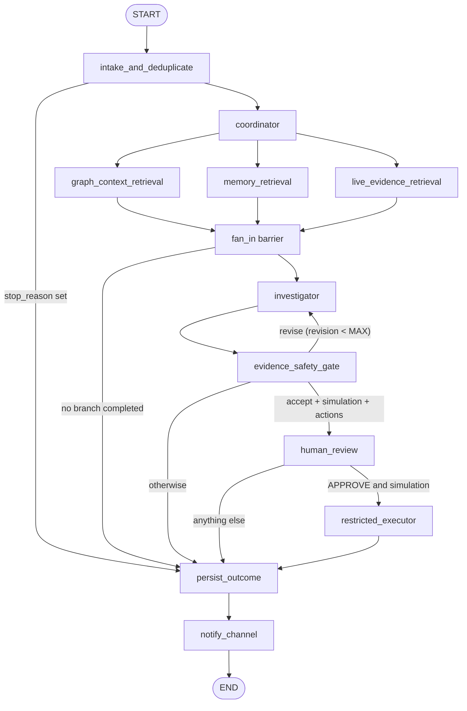

# Phase 4: orchestration

An investigation is one LangGraph run per `AgentSession`. `POST /api/investigations` only creates the session (`queued`). A worker claims it, runs the graph, and writes the outcome back to the graph. Code: `apps/api/app/orchestrator/`. Tests: `tests/test_phase4_orchestrator.py`.

## Node diagram

- The three branches run in parallel. `add_edge([g, m, l], "fan_in")` is a real barrier: `fan_in` runs only after all three have finished (completed, failed or skipped).
- Nodes with no LLM (`intake`, `coordinator`, `fan_in`, `persist`, `notify`, the branches) are plain Python.
- `human_review` and `restricted_executor` are Phase 4 placeholders. Phase 5 replaces `human_review` with `interrupt()`.
- Every node except `persist_outcome` and `notify_channel` first checks the overall run deadline; a late run stops with `timed_out`.

| Node | What it does |
|---|---|
| `intake_and_deduplicate` | Loads the session and its incident. Stops the run with status `failed` and `stop_reason` `incident_missing`, `incident_resolved` or `duplicate` (an earlier-started session for the same incident is still `running`). |
| `coordinator` | Lists the services the incident `AFFECTS`, picks the required branches (telemetry only if there are affected services), sets the live-evidence window (incident start - 2 h .. now) and the run deadline, and records the branch status and investigator name on the session. It never approves or executes anything. |
| `graph_context_retrieval` | `retrieve()` (Phase 3): graph context and knowledge context. |
| `memory_retrieval` | Memory context. Re-checks that each item is `verified`, grounded and validated. |
| `live_evidence_retrieval` | Synthetic telemetry (`app/telemetry/synthetic.py`) for the affected services and path targets. |
| `fan_in` | If no branch completed, the run ends `inconclusive` without calling the investigator. |
| `investigator` / `evidence_safety_gate` | See `docs/investigator.md`. |
| `persist_outcome` / `notify_channel` | The only graph writes of a run (see below). |

The graph and memory branches share one `retrieve()` call per run attempt through `BundleCache`; they still write separate state keys.

## State and reducer

State is `InvestigationState` (`state.py`): JSON-serialisable values only (`model_dump(mode="json")` dicts), so a checkpoint never depends on pickled objects.

| Key | Written by |
|---|---|
| `session_id`, `tenant_id`, `env` | the run input |
| `thread_id`, `mode`, `incident`, `stop_reason`, `revision`, `feedback`, `status`, `error` | `intake` (the gate node later updates `revision`, `feedback`, `status`) |
| `required_branches`, `affected_service_ids`, `window_start_ms`, `window_end_ms`, `deadline_ms` | `coordinator` |
| `graph_context`, `knowledge_context` | `graph_context_retrieval` |
| `memory_context` | `memory_retrieval` |
| `telemetry_context` | `live_evidence_retrieval` |
| `retrieval_status` | all three branches, through the reducer |
| `investigator_result`, `investigator_error` | `investigator` |
| `investigator_name` | `coordinator`, `investigator` |
| `gate` | `evidence_safety_gate`, `fan_in` |
| `review`, `execution` | `human_review`, `restricted_executor` (placeholders) |
| `action_ids` | `persist_outcome` |

`retrieval_status` is `{branch: {status, detail}}` with status `running | completed | failed | skipped`. Its reducer (`merge_status`) merges per-branch entries, so parallel writes never collide. It is the only key with a reducer; no two nodes write the same un-reduced key.

Branch rules: each branch has a timeout (`BRANCH_TIMEOUT_S`, default 20 s) and one retry on a transient `GraphUnavailable`. A failure records `failed` and a short detail (never the raw exception text; that goes to the server log). Only completed branches reach the investigator, so no data is invented.

## Status mapping

| Gate decision / outcome | Session status |
|---|---|
| `accept`, mode `recommendation_only` | `completed` |
| `accept`, mode `simulation`, with actions | `awaiting_review` |
| `recommendation_only` (revisions exhausted, violations kept, actions dropped) | `completed` |
| `escalate` | `escalated` |
| `inconclusive` (also: no branch completed, investigator failed on every attempt) | `inconclusive` |
| unexpected exception | `failed` (+ `error`: exception type only) |
| overall run deadline passed | `timed_out` |

## Revision loop

If the investigator raises `InvestigatorError` (`malformed`, `timeout`, `unavailable`) or the gate returns `revise`, `revision` is incremented, the violation details become `feedback`, and the investigator runs again. The loop is bounded by `MAX_INVESTIGATION_REVISIONS` (default 2): at most 3 investigator attempts. A `revise` at the limit is converted to `recommendation_only` or `inconclusive` as a guard. Persisted as `revision_count` on the session.

## persist_outcome (idempotent)

All ids derive from the session id (`<tenant>.ses.<ulid>`, suffix = `<ulid>`), and every write is a `MERGE`.

- **Telemetry evidence.** Each observation becomes an `Evidence` node under its own stable id, kind `metric`, source `agent`, with `HAS_EVIDENCE` from the incident and `OBSERVED_ON` the service.
- **Session.** `findings_json` (the gate's surviving hypotheses), `summary` (not for an inconclusive gate), `investigator`, `overall_uncertainty`, `gate_json` (decision and violations), `branch_status_json`, `revision_count`, `status`, `ended_at_ms`, `error`.
- **Actions** (gate `accept` only). Per accepted proposal `n`: `AgentAction` id `<tenant>.act.<suffix>.<n>.v1`, `proposal_id` `<tenant>.prop.<suffix>.<n>`, `version` 1, `spec_json = canonical_json({action_type, tenant_id, env, service_id, deployment_id, runbook_id})`, `spec_hash = sha256(spec_json)`, status `proposed` (recommendation_only) or `pending_review` (simulation), edges `PART_OF` the session, `TARGETS` the service, `SUPPORTED_BY` its evidence. An existing action is never rewritten, so a later review is not undone by a repeated persist. Mode is not part of the spec.
- Memories are never touched here; only `app/services/memories.py` verifies them.

`notify_channel` writes one `TimelineEvent` (`<tenant>.tl.<suffix>.outcome`, linked by `HAS_EVENT`) and one JSON log line. No network.

## Checkpoints, thread ids, recovery

- Checkpointer: `PostgresSaver` on the project DSN (`checkpoint.py`). The tables are created only by the library's `setup()` (`scripts/init_checkpointer.py`, or `setup=True` when the worker starts). The project writes no DDL for them.
- `thread_id = AgentSession.thread_id` (`inv-<ulid>`). The graph runs with `durability="sync"`: each superstep is committed before the next starts.
- **Restart recovery.** On its first poll, a worker resumes every session still `running` with `graph.invoke(None, config)` on the same thread id. Completed nodes do not re-run (verified in the tests with call counters on retrieval and telemetry). A session whose graph already finished but whose outcome never reached the graph is finalised without re-running anything.
- A crash is any `BaseException` or a killed process: the session stays `running` and keeps its checkpoint. A normal `Exception` is recorded as `failed`; `RunTimedOut` as `timed_out`.

## Worker

`Worker` (`runner.py`) is started by the FastAPI lifespan when `ORCHESTRATOR_ENABLED=true`, or standalone with `scripts/run_worker.py` (then set `ORCHESTRATOR_ENABLED=false` for the API).

- **Claim.** `queued -> running` is one write query (`claim_session.cypher`). FalkorDB runs one write per graph at a time, so of several claimers exactly one wins; the others get nothing.
- **Run.** Claimed sessions go to `max_workers` run threads (default 2), all daemon threads. `stop()` waits for in-flight runs; one that does not finish keeps its checkpoint and `running` status.
- **Scopes.** Each poll covers every configured tenant x env.
- **One worker per graph.** Claims are atomic, but the startup recovery of `running` sessions is not leased, so two workers could resume the same session.

## Settings

| Env var | Default | Meaning |
|---|---|---|
| `ORCHESTRATOR_ENABLED` | `false` | run the worker inside the API process |
| `ORCHESTRATOR_POLL_S` | `2` | queue poll interval |
| `MAX_INVESTIGATION_REVISIONS` | `2` | revision cap |
| `BRANCH_TIMEOUT_S` | `20` | per-branch timeout |
| `LLM_PROVIDER` | `stub` | `stub` or `ollama` |
| `LLM_TIMEOUT_S` | `90` | per investigator attempt |
| `LLM_FALLBACK_TO_STUB` | `true` | label and use the stub if Ollama fails |

The overall run budget is `2 x BRANCH_TIMEOUT_S + LLM_TIMEOUT_S x (MAX_INVESTIGATION_REVISIONS + 1) + 60 s`.
